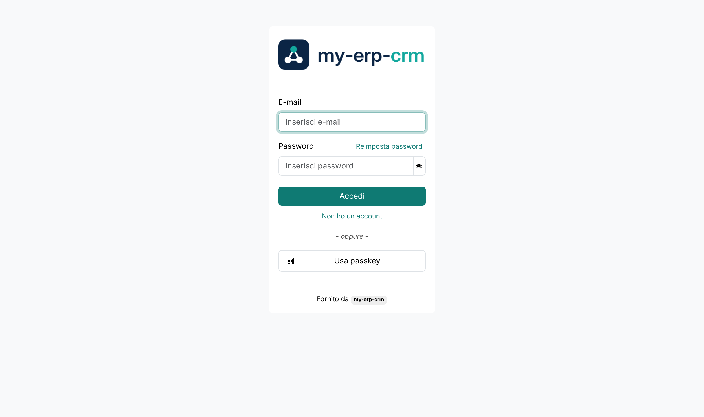
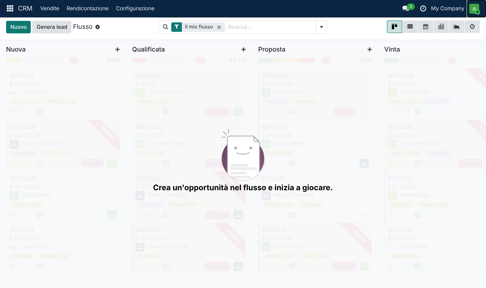

# my-erp-crm


**my-erp-crm** è un gestionale ERP e CRM open source: contatti, opportunità commerciali,
preventivi e ordini, fatturazione, calendario, email e, quando servono, contabilità,
magazzino, progetti e tutte le altre applicazioni incluse.

- **Gratuito** e con **codice sorgente pubblico**
- Licenza **GNU LGPL v3** (vedi [LICENSE](LICENSE))
- Basato su **Odoo Community Edition 19.0** (vedi [NOTICE.md](NOTICE.md))
- Interfaccia in italiano e inglese

| Accesso | CRM |
|---|---|
|  |  |

## Messa online (produzione)

Il server di produzione è **https://erp.kliniksanktmoritz.ch**. A ogni modifica del ramo
`main`, GitHub Actions ([`.github/workflows/pubblica.yml`](.github/workflows/pubblica.yml)):

1. costruisce l'immagine Docker e la pubblica su `ghcr.io/sergiodarpa-bit/my-erp-crm`;
2. se il server è configurato, copia i file di [`deploy/produzione`](deploy/produzione) in
   `/opt/my-erp-crm` ed esegue `aggiorna.sh`: al primo avvio crea il database e configura
   l'azienda; le volte successive fa un **backup del database** e aggiorna i moduli.
   I dati non vengono mai cancellati.

HTTPS è automatico (Caddy con certificato Let's Encrypt).

**Cosa serve sul server:** Linux con Docker e il plugin Compose, porte 80 e 443 libere, e il
record DNS di `erp.kliniksanktmoritz.ch` che punta al suo indirizzo IP.

**Cosa serve su GitHub** (Settings → Secrets and variables → Actions):

| Tipo | Nome | Valore |
|---|---|---|
| Variable | `DEPLOY_HOST` | indirizzo IP o nome del server |
| Variable | `DEPLOY_USER` | utente SSH (predefinito `root`) |
| Secret | `DEPLOY_SSH_KEY` | chiave privata SSH con accesso al server |
| Secret | `DEPLOY_KNOWN_HOSTS` | risultato di `ssh-keyscan <server>` |

Prima del primo avvio, sul server: crea `/opt/my-erp-crm/.env` partendo da
[`deploy/produzione/.env.example`](deploy/produzione/.env.example) (password, dati
dell'azienda). Il file `.env` resta solo sul server.

## Azienda, IVA e prezzi

Lo script [`deploy/configura_azienda.py`](deploy/configura_azienda.py) viene eseguito al primo
avvio con i dati di `.env`:

- **Azienda nel Regno Unito** (`COMPANY_COUNTRY=GB`): piano dei conti britannico, imposte e
  dichiarazione IVA **VAT100**, contabilità in **sterline (GBP)**.
- **IVA sulle vendite**, secondo lo studio IVA del progetto (invarianti INV-IVA-01…10 e
  matrice dei trattamenti), per una società britannica. Il trattamento dipende da **cosa si
  vende**, **chi è il cliente** e **dove si trova**:

  | Cliente | Abbonamento app (dato/piattaforma) | Check-up biometrico (cura) |
  |---|---|---|
  | Regno Unito | IVA UK 20% | Esente (VATA 1994, Sch. 9, Group 7) |
  | Azienda UE con partita IVA **verificata VIES** | Inversione contabile, art. 196 Dir. 2006/112/CE | Esente |
  | Azienda UE **senza** verifica VIES valida | trattata come privato (riga sotto) | Esente |
  | Privato UE | IVA del paese del cliente tramite **OSS** non-UE, con **due prove di localizzazione** | Esente |
  | Resto del mondo (aziende e privati) | Fuori campo IVA UK | Esente |

  Ogni trattamento stampa in fattura la propria **dicitura** (in inglese, e in italiano per i
  clienti di lingua italiana). Il modulo `my_erp_crm_iva` rende i controlli automatici:

  - **VIES** verificato direttamente sul servizio della Commissione europea (pulsante
    *Verifica VIES* sul contatto); esito, data e nome registrato restano sul cliente;
  - l'inversione contabile si applica **solo** con VIES valido, altrimenti il cliente è
    trattato come privato;
  - una fattura **non si emette** senza paese del cliente, con righe senza imposta, in
    inversione contabile senza VIES valido, o in OSS senza le due prove di localizzazione;
  - ogni fattura conserva le **prove** del suo trattamento (*Altre informazioni*).

  **Clienti B2B e autofatturazione.** Per le aziende UE la fattura è senza IVA, riporta la
  loro partita IVA verificata e la dicitura dell'art. 196; la **fattura elettronica UBL/Peppol**
  allegata marca le righe come inversione contabile (codice `AE`, motivo `VATEX-EU-AE`), così il
  gestionale del cliente la importa e genera l'autofattura o l'integrazione (in Italia: documento
  TD17 verso lo SdI) senza ribattere i dati.

  Da confermare con i consulenti prima della prima fattura: registrazione OSS non-UE e Stato
  scelto; qualificazione dei check-up come cura esente; separazione tra attività clinica e
  attività dati/piattaforma (le voci esenti limitano la detrazione dell'IVA sugli acquisti);
  registrazioni IVA locali per i servizi digitali a privati (es. Svizzera, Emirati).
  Gli abbonamenti venduti tramite Apple App Store o Google Play sono fatturati da Apple/Google.
- **Prezzi pubblici in euro**: il listino predefinito è *Public prices (EUR)*. Il prezzo in
  euro di ogni prodotto si imposta nel listino (regola "prezzo fisso"); la contabilità
  converte in sterline.
- **Tassi di cambio** aggiornati ogni giorno con i tassi di riferimento della Banca Centrale
  Europea (modulo `my_erp_crm_currency_ecb`).

## Avvio in locale con Docker

```bash
cp .env.example .env
```

Compila `.env` (password, nome dell'azienda), poi:

```bash
./scripts/init.sh
```

Apri http://localhost:8069 ed entra con `admin` e la password di `ADMIN_PASSWORD`.

## Avvio senza Docker (sviluppo)

Servono Python 3.10–3.13 e PostgreSQL.

```bash
python3 -m venv .venv && .venv/bin/pip install -r requirements.txt
```

```bash
.venv/bin/python my-erp-crm --addons-path=addons -d my-erp-crm -i crm --load-language=it_IT
```

## Cosa abbiamo cambiato rispetto a Odoo Community

| Dove | Cosa |
|---|---|
| tutto il codice e le traduzioni | il nome "Odoo" nei testi diventa "my-erp-crm" ([`scripts/rebrand.py`](scripts/rebrand.py)) |
| `addons/my_erp_crm_brand` | colori e logo; pagina di accesso; menu utente senza link commerciali; sezione *Informazioni* con le note di licenza; niente app e opzioni della versione a pagamento |
| `addons/my_erp_crm_brand_mail` | "Fornito da my-erp-crm" nelle email; assistente "my-erp-crm Bot" |
| `addons/my_erp_crm_brand_portal` | collegamento "Fornito da" nel portale clienti |
| `addons/my_erp_crm_currency_ecb` | tassi di cambio BCE giornalieri |
| `addons/my_erp_crm_iva` | regole IVA: VIES, inversione contabile, OSS, prove in fattura |
| `addons/web/static/img` | logo, icone e favicon |
| `my-erp-crm` | comando di avvio (equivalente a `odoo-bin`) |
| `Dockerfile`, `docker-compose.yml`, `deploy/`, `scripts/`, `.github/` | installazione e pubblicazione |

Il cambio di nome non tocca le note di copyright ("Odoo S.A."), gli indirizzi odoo.com e i
moduli che dialogano con servizi esterni o autorità fiscali (localizzazioni, pagamenti,
fatturazione elettronica), dove i nomi possono avere valore tecnico o legale.

## Aggiornamenti di sicurezza dal progetto originale

Il file `UPSTREAM_COMMIT` indica la versione di Odoo Community da cui partiamo. Per portare
dentro le correzioni pubblicate in seguito sul ramo 19.0:

```bash
./scripts/aggiorna-da-odoo.sh
```

Le modifiche originali passano dallo stesso cambio di nome automatico, così si applicano
senza conflitti; lo script crea un commit e la pubblicazione parte da sola.

## Marchi

"Odoo" è un marchio registrato di Odoo S.A. my-erp-crm non è affiliato a Odoo S.A. né da
essa approvato; il nome compare solo per indicare la provenienza del codice, come richiesto
dalla licenza.
