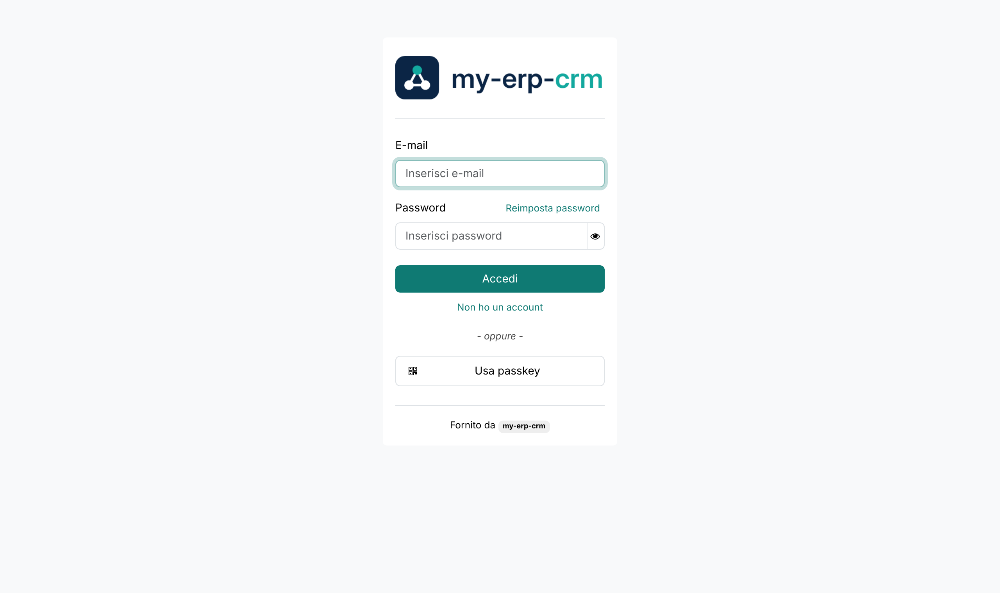
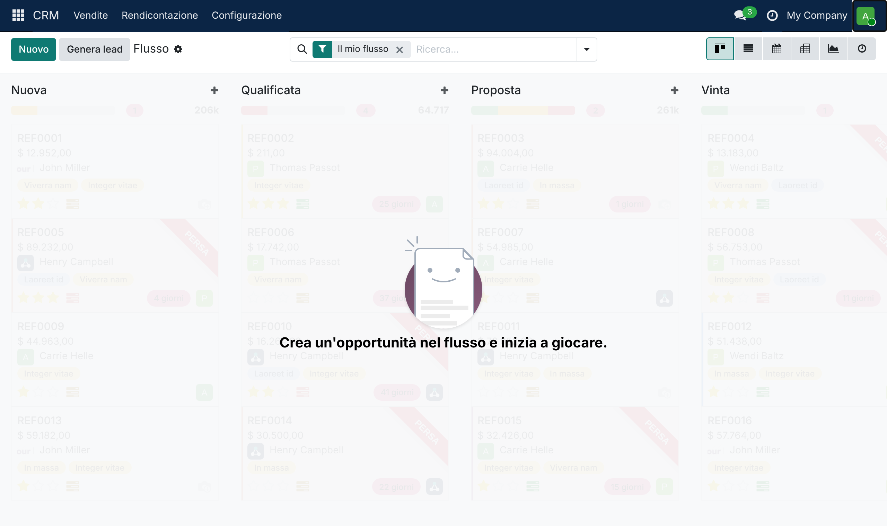

# my-erp-crm


**my-erp-crm** è un gestionale ERP e CRM open source: contatti, opportunità commerciali,
preventivi e ordini, fatturazione, calendario, email e, quando servono, contabilità,
magazzino, progetti e tutte le altre applicazioni incluse.

- **Gratuito** e con **codice sorgente pubblico**
- Licenza **GNU LGPL v3** (vedi [LICENSE](LICENSE))
- Basato su **Odoo Community Edition 20.0** (vedi [NOTICE.md](NOTICE.md))
- Interfaccia in italiano e inglese

| Accesso | CRM |
|---|---|
|  |  |

## Messa online (produzione)

Il server di produzione è **https://erp.kliniksanktmoritz.ch**. A ogni modifica del ramo
`main`, GitHub Actions ([`.github/workflows/pubblica.yml`](.github/workflows/pubblica.yml))
costruisce l'immagine Docker e la pubblica su `ghcr.io/sergiodarpa-bit/my-erp-crm` con due
nomi: `:20.0` (sempre l'ultima) e `:<commit>`. Il commit è scritto anche dentro l'immagine.

Sul server, `aggiorna.sh` porta in produzione la versione indicata da `IMAGE` in `.env`: al
primo avvio crea il database e configura l'azienda; le volte successive fa un **backup del
database** e aggiorna i moduli. I dati non vengono mai cancellati. `IMAGE=…:<commit>` dice
quindi sempre quale versione gira.

HTTPS è automatico (Caddy con certificato Let's Encrypt).

**Cosa serve sul server:** Linux con Docker e il plugin Compose, porte 80 e 443 libere, e il
record DNS di `erp.kliniksanktmoritz.ch` che punta al suo indirizzo IP.

### Aggiornamento automatico dal server (consigliato)

Il server controlla ogni 15 minuti se su ghcr.io c'è una versione nuova di `main` e, se c'è,
si aggiorna da solo ([`aggiorna-da-solo.sh`](deploy/produzione/aggiorna-da-solo.sh) con il
timer `my-erp-crm-aggiorna.timer`). **Nessuna porta in entrata, nessun IP fisso, nessuna
chiave su GitHub**: è il server che chiede. Dopo un merge su `main` la nuova versione è in
produzione entro circa 20 minuti (costruzione dell'immagine più un controllo), con qualche
minuto di fermo dell'applicazione durante l'aggiornamento dei moduli.

Per accenderlo, una volta, sul server:

```bash
sudo bash -c 'set -e; cd /opt/my-erp-crm; B=https://raw.githubusercontent.com/sergiodarpa-bit/my-erp-crm/main/deploy/produzione; for f in aggiorna-da-solo.sh my-erp-crm-aggiorna.service my-erp-crm-aggiorna.timer; do curl -fsSL -o "$f.nuovo" "$B/$f"; mv "$f.nuovo" "$f"; done; chmod 755 aggiorna-da-solo.sh; ./aggiorna-da-solo.sh attiva'
```

Il primo controllo parte subito, come **servizio di sistema**: continua anche se la
connessione SSH cade. Si segue con `journalctl -fu my-erp-crm-aggiorna` (Ctrl+C chiude solo
la visualizzazione); quando finisce, `./aggiorna-da-solo.sh stato`.

Poi, sempre da `/opt/my-erp-crm` con `sudo`:

| Comando | Cosa fa |
|---|---|
| `./aggiorna-da-solo.sh stato` | versione in uso, servizio, contenitori, prossimo controllo, ultimi aggiornamenti |
| `./aggiorna-da-solo.sh` | fa partire subito un controllo, come servizio di sistema |
| `./aggiorna-da-solo.sh spegni` | spegne l'aggiornamento automatico (`AGGIORNA_DA_SOLO=0`) |
| `journalctl -fu my-erp-crm-aggiorna` | segue il controllo in corso (Ctrl+C chiude solo la visualizzazione) |
| `journalctl -u my-erp-crm-aggiorna -n 100` | dettaglio dell'ultimo controllo |

Il controllo non gira mai dentro il terminale: il 18/11/2026 il primo aggiornamento, lanciato
dal terminale, si è interrotto quando è caduta la connessione e ha lasciato l'applicazione
ferma. Ogni aggiornamento lascia una riga in `aggiornamenti.log`. Se `aggiorna.sh` fallisce,
lo script rimette la versione di prima, riaccende l'applicazione e non riprova quella
versione finché non ne esce una nuova (o finché non si cancella `.aggiornamento-fallito`).
Se un aggiornamento si interrompe a metà (riavvio del server, servizio fermato), resta il
file `.aggiornamento-in-corso` e il controllo successivo lo **riprende** da capo. Non parte
mentre gira il backup o un altro script di manutenzione. Gli script di produzione
(`aggiorna.sh`, `docker-compose.yml`, …) li prende dall'immagine nuova, quindi sono sempre
della stessa versione del programma. Tiene la versione in uso e le due precedenti.

Per **tornare a una versione precedente**: prima `./aggiorna-da-solo.sh spegni`, poi in
`.env` si rimette il commit voluto in `IMAGE` e si lancia `aggiorna.sh` come servizio di
sistema, così non dipende dalla connessione:

```bash
sudo systemd-run --collect --unit=my-erp-crm-manuale --working-directory=/opt/my-erp-crm /opt/my-erp-crm/aggiorna.sh
```

e lo si segue con `journalctl -fu my-erp-crm-manuale`.

### In alternativa: pubblicazione da GitHub via SSH

Se il server è configurato su GitHub, dopo la costruzione dell'immagine GitHub entra nel
server via SSH, copia i file di [`deploy/produzione`](deploy/produzione) in
`/opt/my-erp-crm`, scrive in `.env` la versione appena costruita ed esegue `aggiorna.sh`
come root (con `sudo` se l'utente SSH non è root). Richiede la porta 22 del server aperta a
tutto internet, perché GitHub non si collega da indirizzi fissi.

**Cosa serve su GitHub** (Settings → Secrets and variables → Actions):

| Tipo | Nome | Valore |
|---|---|---|
| Variable | `DEPLOY_HOST` | indirizzo IP pubblico fisso del server (su AWS l'IP elastico) o il suo nome, raggiungibile da internet sulla porta 22 |
| Variable | `DEPLOY_USER` | utente SSH (predefinito `root`); un altro utente, come `ec2-user` su AWS, deve avere `sudo` senza password |
| Secret | `DEPLOY_SSH_KEY` | chiave privata SSH con accesso al server |
| Secret | `DEPLOY_KNOWN_HOSTS` | riga `<DEPLOY_HOST> ssh-ed25519 …` con la chiave del server (`/etc/ssh/ssh_host_ed25519_key.pub`) |

`DEPLOY_HOST` e `DEPLOY_USER` vanno create come variabili **del repository**, non
dell'ambiente `produzione`: GitHub decide se pubblicare prima di entrare nell'ambiente, e
lì le variabili dell'ambiente non le vede (la pubblicazione resterebbe "skipped").

Prima del primo avvio, sul server: crea `/opt/my-erp-crm/.env` partendo da
[`deploy/produzione/.env.example`](deploy/produzione/.env.example) (password, dati
dell'azienda). Il file `.env` resta solo sul server.

## Azienda, IVA e prezzi

Lo script [`deploy/configura_azienda.py`](deploy/configura_azienda.py) viene eseguito al primo
avvio con i dati di `.env`:

- **Azienda nel Regno Unito** (`COMPANY_COUNTRY=GB`): piano dei conti britannico e
  contabilità in **sterline (GBP)**. La configurazione IVA preparata è quella di una società
  britannica **non registrata alla VAT** che vende servizi in Europa, in Svizzera e nel resto
  del mondo; se `COMPANY_VAT` è valorizzata lo script si ferma, perché per una società
  registrata le scelte vanno fatte col commercialista.
- **IVA sulle vendite**, scelta automaticamente in base al cliente:

  | Cliente | IVA in fattura | Dicitura in fattura |
  |---|---|---|
  | Regno Unito | nessuna | *No VAT charged: the supplier is not registered for UK VAT.* |
  | Impresa UE con numero IVA **verificato VIES** | nessuna | *Outside the scope of UK VAT. Reverse charge: the customer accounts for any VAT due in its own country.* |
  | Impresa svizzera con numero IVA | nessuna | *Outside the scope of UK VAT. Swiss acquisition tax (Bezugsteuer) may be due by the recipient in Switzerland.* |
  | Impresa o privato del resto del mondo | nessuna | *Outside the scope of UK VAT: place of supply outside the United Kingdom.* |
  | Privato UE (o impresa UE senza VIES valido) | servizi generali: nessuna; **servizi digitali: fattura fermata** finché non c'è la registrazione **OSS non-UE** (`OSS_REGISTERED=1`, poi l'IVA del paese del cliente) | — |

  Le diciture sono in inglese, con la traduzione italiana per i clienti di lingua italiana.
  Il modulo `my_erp_crm_iva` rende i controlli automatici:

  - **VIES** verificato direttamente sul servizio della Commissione europea (pulsante
    *Verifica VIES* sul contatto); se il servizio non risponde l'esito si può impostare a mano
    e resta nella cronologia del contatto;
  - il reverse charge si applica **solo** con VIES valido, altrimenti il cliente è trattato
    come privato;
  - una fattura **non si emette** senza paese del cliente, con righe senza imposta e senza
    posizione fiscale, in reverse charge senza VIES valido, per vendite non ancora ammesse
    (es. servizi digitali a privati UE senza OSS) o in OSS senza due prove di localizzazione;
  - ogni fattura conserva le **prove** del suo trattamento (*Altre informazioni*).

  **Clienti B2B e autofatturazione.** Per le imprese UE e svizzere la fattura è senza IVA e
  porta la dicitura; la **fattura elettronica UBL/Peppol** marca le righe come reverse charge
  (codice `AE`), così il gestionale del cliente la importa. Un modulo esterno di
  autofatturazione (per esempio uno che prepari il TD17 italiano) si collega indicando in
  `SELF_BILLING_FLAG_FIELD` il campo con cui si accende sulle posizioni fiscali.
- **Prezzi pubblici in euro**: il listino predefinito è *Public prices (EUR)*. Il prezzo in
  euro di ogni prodotto si imposta nel listino (regola "prezzo fisso"); la contabilità
  converte in sterline.
- **Tassi di cambio** aggiornati ogni giorno con i tassi di riferimento della Banca Centrale
  Europea (modulo `my_erp_crm_currency_ecb`).

## Posta in uscita

Finché il server di posta in uscita non è configurato e provato **nessuna email parte**
(conferme, preventivi, fatture, richieste di firma). I passi, gli errori tipici e la voce di
attivazione per la versione SaaS sono in [`doc/posta-in-uscita.md`](doc/posta-in-uscita.md).

## Commercio elettronico

Il negozio online è **Sito web → E-commerce**, all'indirizzo del gestionale seguito da `/shop`.
Prima di aprirlo: **Sito web → Configurazione → E-commerce → Controllo di lancio** dice che
cosa manca (prodotti e prezzi in euro, pagamenti Stripe o bonifico, posta in uscita, termini e
condizioni, …). Il negozio applica le regole IVA **prima del pagamento**: un carrello che non
si potrebbe fatturare (per esempio servizi digitali a privati UE senza OSS) non arriva al
pagamento. Se una fattura automatica non si può emettere, il pagamento non si perde: ordine
confermato, fattura in bozza con un'attività. I servizi mensili e annuali sono **abbonamenti**
che si rinnovano da soli sulla carta salvata in Stripe, e il cliente li disdice dal portale. I passi, la prova d'acquisto e dove si vedono i
numeri (Panoramica, Dashboard → E-commerce, Vendite online) sono in
[`doc/commercio-elettronico.md`](doc/commercio-elettronico.md).

## Avvio in locale con Docker

```bash
cp .env.example .env
```

Compila `.env` (password, nome dell'azienda), poi:

```bash
./scripts/init.sh
```

Apri http://localhost:8069 ed entra con `admin` e la password di `ADMIN_PASSWORD`.

## Avvio senza Docker (sviluppo)

Servono Python 3.12–3.14 e PostgreSQL.

```bash
python3 -m venv .venv && .venv/bin/pip install -r requirements.txt
```

```bash
.venv/bin/python my-erp-crm --addons-path=addons -d my-erp-crm -i crm --load-language=it_IT
```

## Cosa abbiamo cambiato rispetto a Odoo Community

| Dove | Cosa |
|---|---|
| tutto il codice e le traduzioni | il nome "Odoo" nei testi diventa "my-erp-crm" ([`scripts/rebrand.py`](scripts/rebrand.py)) |
| `addons/my_erp_crm_brand` | colori e logo; pagina di accesso; menu utente senza link commerciali (anche "My Subscription"); sezione *Informazioni* con le note di licenza; niente app e opzioni della versione a pagamento, né la finestra "passa a Enterprise" |
| `addons/my_erp_crm_brand_mail` | "Fornito da my-erp-crm" nelle email; assistente "my-erp-crm Bot" |
| `addons/my_erp_crm_brand_portal` | collegamento "Fornito da" nel portale clienti |
| `addons/my_erp_crm_brand_sale` | elenco dei preventivi vuoto senza il video promozionale di Odoo |
| `addons/my_erp_crm_brand_crm` | menu "Genera" del CRM senza i servizi a pagamento di Odoo S.A. ("Lead Sourcing", "Mail plugins") |
| `addons/my_erp_crm_brand_digest` | email di riepilogo senza badge dell'app Odoo e senza immagini scaricate dai server di Odoo |
| `addons/my_erp_crm_brand_payment` | metodi di pagamento senza quelli della versione a pagamento |
| `addons/my_erp_crm_currency_ecb` | tassi di cambio BCE giornalieri |
| `addons/my_erp_crm_iva` | regole IVA: VIES, inversione contabile, OSS, prove in fattura |
| `addons/my_erp_crm_appointment` | prenotazioni: calendari pubblici di prenotazione sul sito (modello Calendly), con assegnazione automatica, domande, promemoria, cancellazione e riprogrammazione, opportunita' nel CRM; vedi il suo [README](addons/my_erp_crm_appointment/README.md) |
| `addons/my_erp_crm_home` | **Panoramica**, la pagina dopo l'accesso: una tessera per ogni app installata con un numero chiave (opportunità aperte, preventivi da confermare, prenotazioni e appuntamenti di oggi, documenti da firmare, fatture da incassare); prima voce del menu, al posto della prima app (era il Commercio elettronico) |
| `addons/my_erp_crm_home_website` | con il Sito web installato, l'indirizzo del gestionale (erp.…) apre il gestionale invece della pagina iniziale del sito (era il negozio): la radice «/» porta a /odoo, cioè accesso e poi Panoramica; /shop e gli altri siti non cambiano. Opzione «La radice apre il gestionale» in Sito web → Impostazioni |
| `addons/my_erp_crm_shop` | **negozio online pronto al lancio**: controllo IVA sul carrello prima del pagamento (servizi digitali a privati UE senza OSS, VIES, prove OSS raccolte al checkout e copiate in fattura), pagamento mai perso se la fattura automatica non si emette, controllo di lancio, tessera «ordini online da gestire» nella Panoramica e carrelli fuori dai preventivi, cruscotto E-commerce; si installa da solo con il negozio; vedi la [guida](doc/commercio-elettronico.md) |
| `addons/my_erp_crm_subscription` | **abbonamenti** mensili e annuali venduti dal negozio: carta salvata in Stripe con il consenso del cliente, rinnovo addebitato da solo e fatturato, tre tentativi se non riesce poi sospensione, disdetta dal portale (anche senza account), ricavo mensile ricorrente (MRR); si installa da solo con il negozio; vedi la [guida](doc/commercio-elettronico.md#abbonamenti-mensili-e-annuali) |
| `addons/sign_oca` | firma dei documenti PDF (consensi, contratti) da portale, telefono o gestionale: modulo della Odoo Community Association, licenza AGPL-3, adattato alla 20.0; vedi la [guida](doc/firma-documenti.md) |
| `addons/my_erp_crm_sale_sign` | firma dei preventivi: pulsante «Invia alla firma» (il PDF del preventivo con una pagina per le firme, o un modello di Firma come il contratto), pulsante «Firme» e PDF firmato allegato al preventivo; licenza AGPL-3 come `sign_oca`; vedi la [guida](doc/firma-documenti.md#firmare-i-preventivi-contratti) |
| `addons/web/static/img` | logo, icone e favicon |
| `my-erp-crm` | comando di avvio (equivalente a `odoo-bin`) |
| `Dockerfile`, `docker-compose.yml`, `deploy/`, `scripts/`, `.github/` | installazione e pubblicazione |

Il cambio di nome non tocca le note di copyright ("Odoo S.A."), gli indirizzi odoo.com e i
moduli che dialogano con servizi esterni o autorità fiscali (localizzazioni, pagamenti,
fatturazione elettronica), dove i nomi possono avere valore tecnico o legale.

## Aggiornamenti di sicurezza dal progetto originale

Il file `UPSTREAM_COMMIT` indica la versione di Odoo Community da cui partiamo. Per portare
dentro le correzioni pubblicate in seguito sul ramo 20.0:

```bash
./scripts/aggiorna-da-odoo.sh
```

Le modifiche originali passano dallo stesso cambio di nome automatico, così si applicano
senza conflitti; lo script crea un commit e la pubblicazione parte da sola.

## Marchi

"Odoo" è un marchio registrato di Odoo S.A. my-erp-crm non è affiliato a Odoo S.A. né da
essa approvato; il nome compare solo per indicare la provenienza del codice, come richiesto
dalla licenza.
